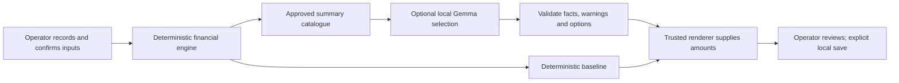

<p align="center">
  
</p>

<h1 align="center">KasiMargin</h1>
<p align="center"><strong>From sales to growth.</strong><br>Good sales. Clearer decisions.</p>

<p align="center">
  <a href="https://github.com/RobynAwesome/KasiMargin/actions/workflows/tests.yml"></a>
  
  
  <a href="LICENSE"></a>
</p>

> **What you earned and what you can spend are different.**
>
> KasiMargin helps an owner-operated township micro-enterprise understand estimated operating margin, protect recorded obligations, and see when cash headroom is still unknown.
>
> **Current stage: runnable local prototype.** Synthetic calculation and adapter tests are established; real Gemma inference and operator outcomes remain unmeasured.

[Quick start](#-quick-start) · [Capabilities](#-key-capabilities) · [Design system](#-design-system) · [Evidence](#-validation-and-evidence) · [Roadmap](#-roadmap)

---

## 🌍 Purpose

Can an open-weight assistant help a business operator understand the daily financial position and evaluate a potential restock decision without manufacturing financial certainty?

The proposed first persona is an owner-operated spaza shop planning tomorrow’s restock. This is a test persona, not an observed customer. Better records and clearer decisions may support a livelihood pathway; synthetic examples do not establish revenue growth, economic value or employment outcomes.

KasiMargin draws conceptual governance inspiration from **Kopano Labs** and Kholofelo Robyn Rababalela’s research. It is an independent greenfield implementation. The README’s visual opening, capability sections, state tables, quick start, repository map, roadmap and design-system section follow the organization of [Introduction-to-MCP](https://github.com/RobynAwesome/Introduction-to-MCP). The statements below are scoped to KasiMargin’s own evidence.

## ✨ Key capabilities

- **Profit and cash, separately** — Estimated operating margin does not become spendable money automatically.
- **Exact ZAR cents** — Deterministic integer arithmetic, with strict types and explicit timestamps.
- **Obligation reconciliation** — Itemized liabilities and committed spending, linked payments, and overlap checks.
- **Unknown stays unknown** — Missing balances, incomplete obligations, stale snapshots and disputed records produce null headroom and HOLD.
- **Local explanation options** — An optional Gemma selection passes programmatic checks before a trusted renderer supplies every amount.
- **Private decision receipts** — Explicit saves retain the displayed result for deterministic reproduction.
- **Light and dark modes** — The owner’s sculpted ribbon emblem sets the orange, lime, teal and blue brand palette.

## 🧭 Product surfaces

| Surface | Role | Current state |
|---|---|---|
| Financial engine | Separate estimated margin from conditional cash headroom | Tested with synthetic scenarios |
| Browser demo | Review records, calculate, explain and save | Strict TypeScript and Python Flask; light and dark themes |
| Gemma adapter | Select approved facts, warnings and options | Local runtime installed; model download blocked by disk capacity |
| Decision receipts | Preserve input/output and replay calculations | Local save and reproduction tested |
| Operator experiment | Measure understanding and usefulness against a baseline | Pending consented trial |
| Public release | Hosted product, demo/video and challenge submission | Pending |

---

## 🚀 Quick start

### 1. Open the checkout

Python **3.10+** and Node.js **24+** are required. The local web layer uses Flask; TypeScript compiles to browser JavaScript. The integer-cents engine remains Python.

```powershell
cd C:\Users\rkhol\KasiMargin
```

For a fresh checkout:

```powershell
git clone https://github.com/RobynAwesome/KasiMargin.git
cd KasiMargin
```

### 2. Install and build locally

```powershell
python -m venv .venv
.\.venv\Scripts\python.exe -m pip install -e .
npm ci
npm run check
.\.venv\Scripts\python.exe -m unittest discover -s tests -v
```

Browser source lives in `kasimargin/web/src/*.ts`. The strict compiler writes ignored `kasimargin/web/build/*.js`; rebuild after editing TypeScript. Flask serves only those generated assets and the existing local logo/styles.

### 3. Start the local demo

```powershell
.\.venv\Scripts\python.exe -m kasimargin --serve
```

Open **[http://127.0.0.1:8765](http://127.0.0.1:8765)**. Choose a synthetic scenario, review its records, and calculate the position. Use the **Light / Dark** controls in the header; the preference is stored in this browser. The first visit follows the operating system’s colour preference.

The app serves its fonts, scripts and images locally without CDNs or analytics. It binds to loopback and is a development demo. Loading an example labels it synthetic. Only select operator-attested records after replacing the example with your own complete records and appropriate decision timestamps.

### 4. Save or reproduce a decision

```powershell
.\.venv\Scripts\python.exe -m kasimargin fixtures/01.json
.\.venv\Scripts\python.exe -m kasimargin fixtures/04.json
.\.venv\Scripts\python.exe -m kasimargin fixtures/itemized/01.json --save
.\.venv\Scripts\python.exe -m kasimargin --verify local-data/decisions/decision-REPLACE_WITH_ACTUAL_ID.json
```

The CLI accepts a fixture wrapper or raw request JSON. Saving raw requests requires `--data-class SYNTHETIC` or `--data-class OPERATOR_ATTESTED`. Browser saves retain the exact displayed result without rerunning inference. Ordinary calculations do not save records.

## 🧮 Financial contract

```text
estimated operating margin = recorded sales - attributable costs

conditional cash headroom = max(0, confirmed cash
                                  - unpaid due liabilities
                                  - separately committed spending
                                  - protected buffer)
```

All calculation amounts are integer ZAR cents. Decimal floats, booleans, numeric strings and negative money inputs are rejected; calculated margins may be negative. The browser converts rand text through integer arithmetic and rejects inputs outside its exact number range. The CLI retains Python integer precision.

Uncollected credit sales can contribute to recorded margin but are excluded from cash. Paid expenses and collected sales already belong in the cash snapshot and are never deducted or added again. Missing cash, buffer, obligations or unresolved cash records return **null headroom and HOLD**.

V1 uses operator-prepared aggregate totals. V2 derives totals from itemized obligations, reconciles paid amounts to confirmed transactions, and detects overlapping references and reused payment allocations. Completeness remains an operator assertion: omitted debts cannot be discovered automatically. Legitimate split payments sharing one reference currently require human resolution under the conservative duplicate gate.

**Conditional headroom is not a purchase approval or a guarantee that spending is safe.** Margin uses operator-prepared attributable costs, and the system does not independently verify a bank balance. See [the implementation contract](docs/LOCAL-FOUNDATION.md) and the [v1](docs/input.schema.json) / [v2](docs/input-v2.schema.json) schemas.

## 🤖 Optional local Gemma

Evaluation candidates: **[Gemma 4 E2B and E4B](https://ollama.com/library/gemma4)**, accessed through [Ollama’s local chat API](https://docs.ollama.com/api/chat). The adapter connects only to `127.0.0.1:11434`, rejects cloud tags and never downloads weights automatically.

Once Ollama and a candidate are explicitly installed:

```powershell
.\.venv\Scripts\python.exe -m kasimargin fixtures/05.json --model gemma4:e2b-it-q4_K_M
```



The model receives the approved catalogue rather than raw transaction descriptions. Only approved fact, warning and action IDs are admitted. Known profit/cash figures, material risks and all warnings must be surfaced. Unsupported prose, invented actions, omitted warnings, incomplete responses and digest drift are rejected; failures use a labelled deterministic fallback.

**Real Gemma inference has not been run.** The official Windows Ollama installation now responds locally as version 0.40.3. The explicit E2B pull failed when the model volume ran out of space, so no model digest is available. Only weights created by that failed pull were removed to restore working space. Seven checks against the real endpoint correctly used labelled deterministic fallback and retained every baseline summary and selection; they are model-absence checks, not inference results. See the [redacted runtime blocker receipt](docs/receipts/gemma-runtime-blocker-2026-10-13.json).

The next requirement is **at least 8 GiB free on the local model volume** before retrying the approximately 4.6 GB E2B download. This reserve is a setup precaution, not proof that inference fits. [The stack and evaluation guide](docs/TYPESCRIPT-FLASK-AND-GEMMA.md) provides the exact retry commands. Device fit, cold/warm model latency, language quality and benefit over the deterministic baseline remain unmeasured. E4B is deferred. The narrow selection task must demonstrate usefulness before we claim AI is essential.

---

## 🎨 Design system

The **KasiMargin Sculpted Ribbon Emblem** is the owner-designated logo. Its original PNG is preserved unchanged at [`kasimargin/web/assets/kasimargin-ribbon-emblem.png`](kasimargin/web/assets/kasimargin-ribbon-emblem.png).

Its warm orange/yellow, lime, teal and blue inform the interface. Both modes use the same logo, type hierarchy and semantic states; colour never replaces the written HOLD/unknown labels.

| Role | Light mode | Dark mode |
|---|---|---|
| Page | Warm ivory `#F8F5ED` | Deep blue `#0B1724` |
| Surface | Soft white `#FFFEFA` | Blue slate `#112331` |
| Main text | Deep green `#173B36` | Pale mint `#EDF6F1` |
| Action | Deep teal `#096B60` | Mint teal `#73E0C7` |
| Cash card | Lime wash `#E0EFA9` | Forest teal `#163E37` |
| Warm accent | Burnt orange `#A95008` | Amber `#FFB55C` |
| Shared ribbon colours | Orange `#F58A17`, lime `#C7ED63`, teal `#16BDA8`, blue `#177BC7` | Same brand family |

The mode selector uses native buttons with `aria-pressed`, keyboard focus indicators and browser-local preference storage. It does not change financial inputs or invalidate a calculated result. Token definitions and interaction details are in [the brand and theme guide](docs/BRAND-AND-THEMES.md).

## 📁 Repository layout

| Path | Purpose |
|---|---|
| `kasimargin/engine.py` | Exact money calculations and evidence gates |
| `kasimargin/obligations.py` | Itemized obligation/payment reconciliation |
| `kasimargin/ollama.py` | Optional local inference adapter |
| `kasimargin/explanations.py` | Selection validation and trusted rendering |
| `kasimargin/receipts.py` | Explicit private saving and replay |
| `kasimargin/server.py` | Flask application factory and loopback WSGI server |
| `kasimargin/web/src/` | Strict TypeScript browser source and API contracts |
| `kasimargin/web/build/` | Ignored JavaScript emitted by the compiler |
| `kasimargin/web/` | Logo, theme tokens and browser interface |
| `fixtures/` | Seven synthetic scenarios |
| `tests/` | Calculation, reconciliation, model-boundary and receipt checks |
| `scripts/evaluate_local_gemma.py` | Seven-scenario cold/warm comparison with private raw traces |
| `docs/receipts/` | Dated public validation and delivery evidence |
| `local-data/` | Ignored private business records and runtime receipts |
| `NOW.md` | Current objective, evidence, uncertainty and handoff |

## ✅ Validation and evidence

The current TypeScript/Flask implementation has **46 passing unittest methods**, strict TypeScript checks/build, seven synthetic scenarios and 20 repeated oversized-request rejection checks. GitHub Actions builds the frontend and tests Windows/Ubuntu with Python 3.10/3.14. Hosted checks are tied to their observed commit; the badge reports `main`.

- [Foundation validation](docs/receipts/local-foundation-2026-10-13.json)
- [Foundation Cloud delivery](docs/receipts/cloud-delivery-2026-10-13.json)
- [TypeScript and Flask validation](docs/receipts/stack-migration-2026-10-13.json)
- [Gemma runtime recovery and disk blocker](docs/receipts/gemma-runtime-blocker-2026-10-13.json)
- [Prepared consented operator comparison](docs/OPERATOR-COMPARISON.md)
- [Current handoff](NOW.md)

Examples and screenshots are synthetic. Receipt replay confirms content integrity and deterministic reproduction; it does not authenticate an author or certify bank verification, consent or human approval. The original [Day 1 contract](docs/DAY1-CONTRACT.md), [Cloud provenance](docs/cloud-provenance.json) and [validation receipt](docs/validation-receipt.json) retain their dated scope.

## 🗺️ Roadmap

| Stage | Outcome | State |
|---|---|---|
| 1. Financial foundation | Exact calculations, uncertainty gates and seven scenarios | Implemented and tested |
| 2. Brand and interface | Supplied logo, light/dark modes and readable decision workflow | Branding merged; TypeScript/Flask migration in PR #3 |
| 3. Model evaluation | E2B/E4B on target hardware versus deterministic baseline | Runtime installed; E2B weights blocked by disk capacity; E4B deferred |
| 4. Operator experiment | Consented comprehension, task time, errors and supervision evidence | Pending |
| 5. Public demo and submission | Truthful demo/video and DEV article | Pending |

## 🔒 Privacy and human choice

Real records, receipt images, model responses and personal identifiers belong in ignored `local-data/`, never in Git. The app cannot authorize transfers, loans, purchases or tax determinations. Robyn retains consequential authority; technical validation and economic outcomes are separate.

The theme preference stores only `light` or `dark` under `kasimargin-theme`. Business records are saved only on explicit action. The local server has no public authentication or multi-user isolation and remains a development surface.

## 🏁 Project origin and challenge

Repository created: **2026-10-12 22:07:26 UTC / 2026-10-13 00:07:26 SAST**. Initial Cloud commit: `5897456485b15474e8cbbf1c8b13f68a04533788`. The owner-supplied scaffold carries an October 12 receipt; dates and historical claims are preserved.

Target: [Hacktoberfest 2026 Week 2 — Side Hustle](https://dev.to/challenges/hacktoberfest-week2-2026-10-12). Official cutoff: **October 19 at 08:59 SAST**, converted from October 18 at 11:59 PM PDT. Individual eligibility, meaningful model contribution, a consented first-user experiment and submission remain pending. No payment, economic value, job creation or production deployment is claimed.

## License and contribution

Prototype code: [MIT](LICENSE). Model weights, Ollama and future dependencies retain their own licenses. Read [AGENTS.md](AGENTS.md), then [NOW.md](NOW.md), and retain source attribution and exact validation receipts for material work.
