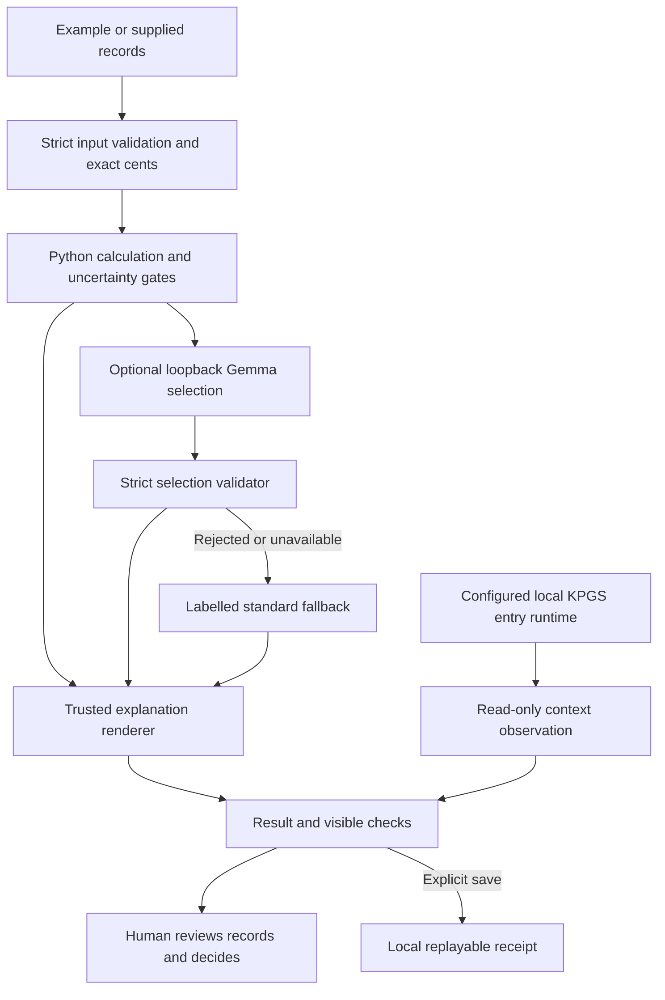

# A clearer daily picture for a South African micro-business

Design decision, 15 October 2026. The owner asks for warmth, simplicity, efficiency and an interface that explains what a person is doing. This is a researched design hypothesis implemented in the local prototype; no merchant study has established that it improves understanding.

## Who, what, when, where and why

The first test persona is an owner-operated spaza shop preparing a restock decision. The person may have paid sales, customers buying on credit, supplier bills and money already promised elsewhere. The product separates a period's estimated operating margin from cash left after recorded obligations and a chosen reserve. It does not discover missing debts or approve a purchase. The cash count, decision time and planning horizon are explicit; the prototype permits a maximum cash-count age of 15 minutes. Dates in the form use South African time, with timezone-aware instants in the contracts.

The browser currently runs on the same computer as the Python service. Responsive layout is preparation for small screens, not a delivered mobile service: loopback on a phone would refer to the phone, not this computer. Public hosting, multi-user security, offline installation and phone access remain separate work.

The financial question is practical: a good sales day can still leave too little available cash for restocking. A customer owing money cannot pay today's supplier until that money is collected. Missing information must feel like a clear next check, without inventing an encouraging balance.

## Research and its limits

FinMark Trust's [FinScope MSME South Africa 2024 release](https://www.finmark.org.za/knowledge-hub/articles/finscope-msme-south-africa-2024-key-findings-highlight-urgent-need-for-informal-sector-support?entity=blog), dated 16 September 2024 and inspected 15 October 2026, describes an MSME economy that remains largely cash-driven despite greater digital financial service use. This supports showing cash and credit separately. These national findings do not establish the needs of a particular township, language group or individual merchant.

Stats SA's [General Household Survey 2025, table 14.1](https://www.statssa.gov.za/publications/P0318/P03182025.pdf), inspected 15 October 2026, reports household internet access through mobile devices at 78.9%, compared with 20.6% for fixed internet at home. This is household access evidence, not evidence of merchant device ownership or product demand. It motivates a narrow-screen layout and avoiding mandatory media downloads.

[Nielsen Norman Group's progressive disclosure guidance](https://www.nngroup.com/articles/progressive-disclosure/) motivates placing ordinary tasks first and specialist detail behind clearly named disclosures. The choice of features still requires observation with intended users. A tour, chatbot or translated interface is not automatically simpler.

## Implemented first use

- A welcome panel offers **Try a shop example** and **Start my own day**. The default displayed figures are explicitly synthetic. The own-day choice starts with unknown money and unchecked confirmation, rather than carrying example values into someone's business.
- Persistent field explanations describe sales, matched costs, available cash, unpaid bills, other promises and a chosen reserve. Blank means unknown; zero must be a deliberate assertion.
- **Help me understand KasiMargin** explains the task in four short parts: bring figures, distinguish margin and cash, review uncertainty, choose whether to keep a copy. It also explains draft loss on reload and where saved/exported copies go.
- Transactions record what happened without silently modifying reviewed totals or the cash snapshot. Unfinished entries block calculation. Edits invalidate old results and relevant own-record confirmations.
- A calm HOLD message preserves the unknown result and points back to records. The full trusted explanation retains required warnings. Calculated results do not become purchase approval.
- Standard calculation is the default. Optional model choices and source settings are disclosed separately. **How this was checked** identifies supplied/synthetic records, model fallback or admission, read-only context availability and the remaining human review.

The help is deterministic interface copy and works without a model. There is no external analytics call, signup requirement or new network service in this implementation. Existing local assets and light/dark modes remain. English is the current interface language; other South African languages need participant choice, reviewed translations and separate testing. No language preference is inferred from geography or the word "kasi".

## Four core contracts

| Contract | Source | Purpose and user meaning |
|---|---|---|
| Aggregate input | `docs/input.schema.json` | Operator-prepared period totals, cash snapshot, horizon, evidence references and transactions; "what I know about this day" |
| Itemized input | `docs/input-v2.schema.json` | Individual obligations and linked payments; "which bills remain and which payment belongs to each" |
| Financial summary | `docs/summary.schema.json` | Python-computed amounts, cash basis, flags and HOLD; "what these records support and what stays unknown" |
| Model selection | `docs/model-selection.schema.json` | Approved identifiers only; "which checked explanation points to show"; the model cannot supply monetary arithmetic or free-form advice |

All four are checked against the seven synthetic fixtures. JSON Schema describes structural and selected consistency rules; Python remains the arithmetic, reconciliation and output-validation authority. The summary contract cannot independently prove every arithmetic relationship. No canonical KPGS formula is renamed or approximated by these application contracts.

## Hybrid architecture and human authority

`kasimargin/kpgs.py` invokes the existing local context entry command with an explicit configured checkout, an isolated Python process, bytecode disabled, a five-second timeout and project-contained ledger environment. It does not pass financial records, assert entry, write the parent's log, compile governance or claim an identity seat. The observed schema and required literal are checked before connection is displayed. Missing configuration, unavailable processes and invalid replies have distinct statuses.

This is an actual runtime connection with a **read-only context-entry scope**. Formal financial admission by a canonical governance runtime remains **NOT_ESTABLISHED**. Context availability does not gate or certify the deterministic financial calculation. Bank verification remains **NOT_PERFORMED**. The displayed context observation is preserved with browser decision receipts; replay validates its bounded claims without re-running a historical probe. Old receipts without it remain valid. Checksums/replay do not authenticate an author or independently establish that a claimed connection occurred.

## Next separate experiment

Use the [consented operator comparison](OPERATOR-COMPARISON.md). Ask participants to explain margin versus cash, identify credit still uncollected, respond to missing records and locate a saved copy. Compare standard and admitted-model explanations with the same synthetic facts, recording mistakes, time, perceived clarity and whether help was useful. Ask which language and device they prefer. Permit stopping or declining. Recruitment, contact, consent and outcomes have not occurred; technical tests cannot substitute for them.
